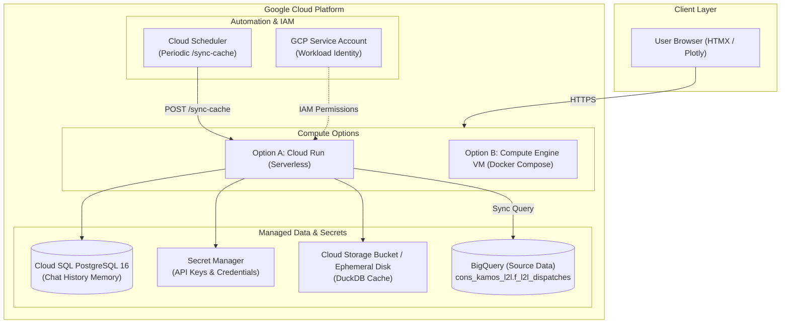

# Google Cloud Platform (GCP) Porting & Deployment Guide
## L2L Analytics Chatbot

This guide provides an end-to-end blueprint and step-by-step instructions for porting the **L2L Manufacturing Analytics Chatbot** to Google Cloud Platform (GCP).

---

## 1. Architectural Overview & Options

The application comprises four primary components:
1. **Frontend / Web API**: FastAPI + Uvicorn + Jinja2 + HTMX + Tailwind + Plotly.
2. **AI & Agent Core**: LangChain / LangGraph ReAct agent with NeMo Guardrails.
3. **Conversational Memory**: PostgreSQL 16 database storing LangGraph checkpoints.
4. **OLAP Cache & Query Engine**: Embedded DuckDB (`data/l2l_analytics.duckdb`) periodically synchronized from Google BigQuery (`cons_kamos_l2l.f_l2l_dispatches`).



### Choosing the Right Deployment Path

| Criterion | Option A: Cloud Run + Cloud SQL (Recommended) | Option B: Compute Engine VM (Lift & Shift) |
| :--- | :--- | :--- |
| **Architecture** | Fully managed serverless container + managed DB | Single VM running `docker-compose` |
| **Scalability** | Auto-scales from 0 to N instances | Fixed capacity (vertical scaling) |
| **Maintenance** | Zero OS patching, automated TLS certificates | Manual Docker/OS security updates |
| **Cost** | Pay-per-request + Cloud SQL base cost | Fixed hourly VM price (e.g., e2-standard-2) |
| **Complexity** | Moderate (Cloud SQL connection, Secret Manager) | Very Low (Exact mirror of local development) |

---

## 2. Prerequisites & Initial GCP Setup

### 2.1 Tooling Required
* Google Cloud CLI (`gcloud`) installed and authenticated.
* Docker CLI installed.
* Target GCP Project created (e.g., `k-qualitytower-0001-p` or a dedicated deployment project).

### 2.2 Configure gcloud CLI
```bash
# Set your target project
gcloud config set project <YOUR_PROJECT_ID>

# Set default compute region (e.g., us-central1 or europe-west1)
gcloud config set compute/region europe-west1
```

### 2.3 Enable Required GCP APIs
```bash
gcloud services enable \
    run.googleapis.com \
    sqladmin.googleapis.com \
    artifactregistry.googleapis.com \
    secretmanager.googleapis.com \
    bigquery.googleapis.com \
    cloudbuild.googleapis.com \
    cloudscheduler.googleapis.com
```

---

## 3. Option A: Cloud-Native Deployment (Cloud Run + Cloud SQL)

### Step 1: Create Dedicated Service Account & IAM Roles
Avoid static JSON credential files by assigning a managed service account to Cloud Run.

```bash
# 1. Create runtime Service Account
gcloud iam service-accounts create l2l-chatbot-sa \
    --display-name="L2L Analytics Chatbot Service Account"

# 2. Grant BigQuery Data Viewer and Job User roles
gcloud projects add-iam-policy-binding <YOUR_PROJECT_ID> \
    --member="serviceAccount:l2l-chatbot-sa@<YOUR_PROJECT_ID>.iam.gserviceaccount.com" \
    --role="roles/bigquery.dataViewer"

gcloud projects add-iam-policy-binding <YOUR_PROJECT_ID> \
    --member="serviceAccount:l2l-chatbot-sa@<YOUR_PROJECT_ID>.iam.gserviceaccount.com" \
    --role="roles/bigquery.jobUser"

# 3. Grant Cloud SQL Client role
gcloud projects add-iam-policy-binding <YOUR_PROJECT_ID> \
    --member="serviceAccount:l2l-chatbot-sa@<YOUR_PROJECT_ID>.iam.gserviceaccount.com" \
    --role="roles/cloudsql.client"
```

---

### Step 2: Provision Cloud SQL (PostgreSQL 16)
The application requires PostgreSQL for LangGraph conversation checkpoints (`checkpoints` and `checkpoint_blobs` tables).

```bash
# 1. Create a Cloud SQL PostgreSQL 16 instance
gcloud sql instances create l2l-chat-postgres \
    --database-version=POSTGRES_16 \
    --tier=db-custom-1-3840 \
    --region=europe-west1 \
    --root-password="<STRONG_ROOT_PASSWORD>" \
    --storage-size=10GB \
    --storage-auto-increase

# 2. Create the application database
gcloud sql databases create l2l_chat_memory \
    --instance=l2l-chat-postgres

# 3. Create the application user
gcloud sql users create postgres \
    --instance=l2l-chat-postgres \
    --password="<APP_USER_PASSWORD>"

# 4. Note the Cloud SQL Connection Name:
# Format: <YOUR_PROJECT_ID>:europe-west1:l2l-chat-postgres
```

---

### Step 3: Configure Google Secret Manager
Store sensitive secrets securely in Secret Manager rather than baking them into environment variables.

```bash
# 1. OpenAI / Gemini API Keys
echo -n "sk-proj-YOUR_OPENAI_KEY" | gcloud secrets create OPENAI_API_KEY --data-file=-
echo -n "YOUR_GEMINI_KEY" | gcloud secrets create GEMINI_API_KEY --data-file=-

# 2. Database Password
echo -n "<APP_USER_PASSWORD>" | gcloud secrets create DB_PASSWORD --data-file=-

# 3. Grant the Service Account permission to read secrets
gcloud secrets add-iam-policy-binding OPENAI_API_KEY \
    --member="serviceAccount:l2l-chatbot-sa@<YOUR_PROJECT_ID>.iam.gserviceaccount.com" \
    --role="roles/secretmanager.secretAccessor"

gcloud secrets add-iam-policy-binding GEMINI_API_KEY \
    --member="serviceAccount:l2l-chatbot-sa@<YOUR_PROJECT_ID>.iam.gserviceaccount.com" \
    --role="roles/secretmanager.secretAccessor"

gcloud secrets add-iam-policy-binding DB_PASSWORD \
    --member="serviceAccount:l2l-chatbot-sa@<YOUR_PROJECT_ID>.iam.gserviceaccount.com" \
    --role="roles/secretmanager.secretAccessor"
```

---

### Step 4: Set Up Artifact Registry & Build Container Image

```bash
# 1. Create Docker repository in Artifact Registry
gcloud artifacts repositories create l2l-repo \
    --repository-format=docker \
    --location=europe-west1 \
    --description="L2L Analytics Chatbot Docker Repository"

# 2. Build and push image using Cloud Build
gcloud builds submit --tag europe-west1-docker.pkg.dev/<YOUR_PROJECT_ID>/l2l-repo/l2l-chatbot:latest .
```

---

### Step 5: Handling the DuckDB Cache in Cloud Run

DuckDB is an embedded database file stored at `/app/data/l2l_analytics.duckdb`.
In Cloud Run:
* **Option 5A (In-Memory / Local Ephemeral Storage - Simplest)**:
  Cloud Run provides an in-memory ephemeral disk (up to instance memory limit). When a container cold-starts, it calls `/sync-cache` (or syncs on startup) to pull the latest dataset from BigQuery.
* **Option 5B (Cloud Storage Volume Mount - Persistent)**:
  Cloud Run supports mounting a Cloud Storage bucket as a volume using Cloud Storage FUSE.
  ```bash
  # Create a bucket for the DuckDB file
  gcloud storage buckets create gs://<YOUR_PROJECT_ID>-l2l-cache --location=europe-west1
  ```
  Mount it to `/app/data` at deployment time.

---

### Step 6: Deploy Application to Cloud Run

Deploy the service, linking the Cloud SQL instance, environment variables, secrets, and minimum instances:

```bash
gcloud run deploy l2l-analytics-app \
    --image=europe-west1-docker.pkg.dev/<YOUR_PROJECT_ID>/l2l-repo/l2l-chatbot:latest \
    --region=europe-west1 \
    --platform=managed \
    --allow-unauthenticated \
    --service-account=l2l-chatbot-sa@<YOUR_PROJECT_ID>.iam.gserviceaccount.com \
    --port=8000 \
    --memory=2Gi \
    --cpu=2 \
    --min-instances=1 \
    --max-instances=5 \
    --add-cloudsql-instances=<YOUR_PROJECT_ID>:europe-west1:l2l-chat-postgres \
    --set-env-vars="\
MODEL_PROVIDER=openai,\
OPENAI_MODEL=gpt-4o,\
GEMINI_MODEL=gemini-1.5-pro,\
GCP_PROJECT_ID=<YOUR_PROJECT_ID>,\
POSTGRES_URL=postgresql://postgres:REPLACE_WITH_SECRET@/l2l_chat_memory?host=/cloudsql/<YOUR_PROJECT_ID>:europe-west1:l2l-chat-postgres" \
    --set-secrets="\
OPENAI_API_KEY=OPENAI_API_KEY:latest,\
GEMINI_API_KEY=GEMINI_API_KEY:latest"
```

> [!NOTE]
> When connecting Cloud Run to Cloud SQL via `--add-cloudsql-instances`, PostgreSQL is reached via the Unix domain socket `/cloudsql/<YOUR_PROJECT_ID>:<REGION>:<INSTANCE_NAME>`.

---

### Step 7: Automated BigQuery Sync via Cloud Scheduler
To keep the DuckDB cache up to date without manual intervention:

```bash
# Create a cron job triggering /sync-cache every 6 hours
gcloud scheduler jobs create http l2l-cache-sync-job \
    --location=europe-west1 \
    --schedule="0 */6 * * *" \
    --uri="https://<YOUR-CLOUD-RUN-URL>/sync-cache" \
    --http-method=POST \
    --attempt-deadline=300s
```

---

## 4. Option B: Compute Engine VM (Fastest 1:1 Lift & Shift)

If you prefer to maintain the exact `docker-compose.yml` configuration without refactoring database connections:

### Step 1: Create a VM with Docker and BigQuery Permissions
```bash
gcloud compute instances create-with-container l2l-vm \
    --zone=europe-west1-b \
    --machine-type=e2-standard-2 \
    --boot-disk-size=30GB \
    --scopes=cloud-platform \
    --tags=http-server,https-server \
    --service-account=l2l-chatbot-sa@<YOUR_PROJECT_ID>.iam.gserviceaccount.com
```

### Step 2: Open Firewall Ports
```bash
gcloud compute firewall-rules create allow-l2l-http \
    --allow=tcp:80,tcp:443,tcp:8000 \
    --target-tags=http-server \
    --description="Allow traffic to L2L Chatbot"
```

### Step 3: Run the Application on the VM
SSH into the instance:
```bash
gcloud compute ssh l2l-vm --zone=europe-west1-b
```

Inside the VM:
```bash
# 1. Install Docker & Docker Compose plugin
sudo apt update && sudo apt install -y docker.io docker-compose-plugin git

# 2. Clone repository
git clone https://github.com/<YOUR-ORG>/l2l-analytics-chatbot.git
cd l2l-analytics-chatbot

# 3. Create .env file from .env.example
cp .env.example .env
nano .env  # Enter your API keys and configuration

# 4. Start the stack in background
sudo docker compose up -d --build
```

---

## 5. Security & Production Checklist

- [ ] **No Service Account Keys Stored in Containers**: Cloud Run and GCE use Application Default Credentials (ADC) provided by the metadata service automatically.
- [ ] **Data Retention**: Ensure Cloud SQL has automated daily backups enabled.
- [ ] **NeMo Guardrails Active**: Ensure `config/config.yml` is packaged in the Docker build.
- [ ] **BigQuery Cost Controls**: Enforce query byte caps or rely on DuckDB cache to limit repetitive BigQuery scans.
- [ ] **HTTPS / Domain Mapping**: Map a custom corporate domain via Cloud Run Custom Domains or Google Cloud Load Balancing with managed SSL certificates.

---

## 6. How to Convert this Guide to PDF

To convert this markdown file into a PDF document:
* **In VS Code / Antigravity**: Open this file (`GCP_MIGRATION_GUIDE.md`), install the `Markdown PDF` or `Markdown Preview Enhanced` extension, right click and select **Export (pdf)**.
* **Via CLI (Pandoc + wkhtmltopdf / Weasyprint)**:
  ```bash
  pandoc GCP_MIGRATION_GUIDE.md -o GCP_MIGRATION_GUIDE.pdf --pdf-engine=weasyprint
  ```
