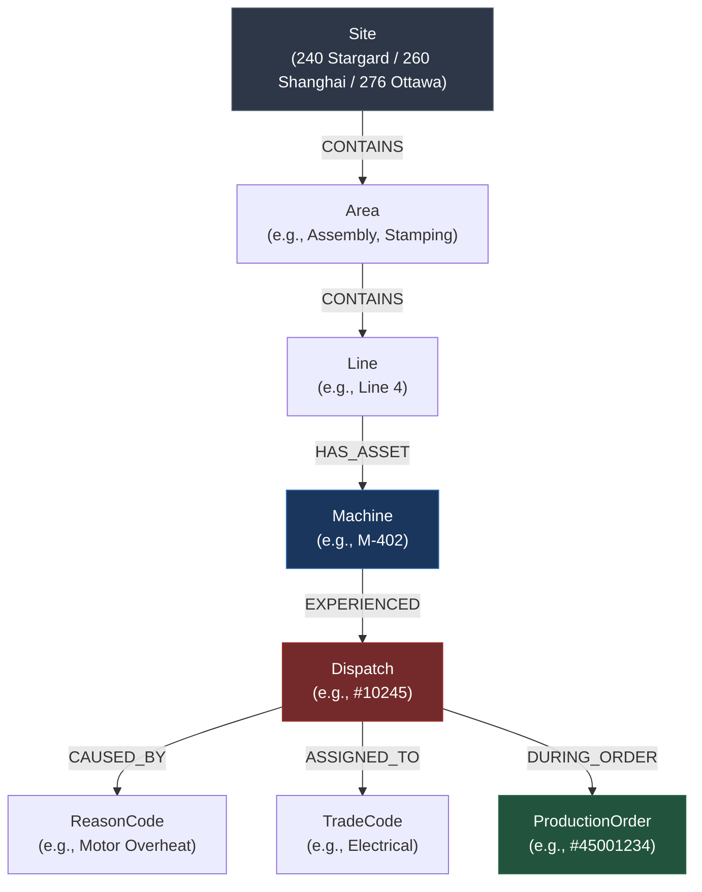
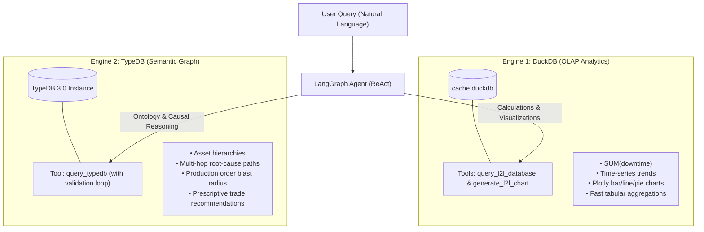

# Knowledge Graph (KG) Use Cases, Architecture & Roadmap for L2L Analytics

## 1. Executive Summary & Vision

The L2L Analytics Chatbot currently operates on a two-tier relational model (Google BigQuery $\to$ embedded DuckDB). While SQL is optimal for flat aggregations (e.g., `SUM(downtime)`, `GROUP BY site`), it is structurally limited when answering:
- **Multi-hop root-cause questions**: *"When Machine X failed during Production Order Y, what upstream equipment or trade skills were involved?"*
- **Semantic disambiguation**: Mapping human language (e.g., *"the packaging line in Shanghai"*) to concrete machine identifiers across sites.
- **Explainable recommendations**: *"Who should be assigned to fix this fault, based on how similar breakdowns were resolved in the past?"*

Integrating a **Knowledge Graph (KG)** builds an explicit semantic web over the existing manufacturing data, turning relational tables into connected operational intelligence.

---

## 2. Core Conceptual Graph Model

The L2L dataset maps naturally into nodes (entities) and edges (relationships):



---

## 3. Progressive Use Cases (From Learning to Advanced)

### Level 1: Starter Use Cases (Beginner — Best for Learning)

#### Use Case 1.1: Plant Asset Hierarchy & Disambiguation Graph
* **Entities**: `Site` $\to$ `Area` $\to$ `Line` $\to$ `Machine`
* **Why it's great for beginners**: It is a static hierarchy with zero temporal complexity, derived directly from distinct values in `f_l2l_dispatches`.
* **Chatbot Value**:
  * *User asks:* *"What is the downtime status of the packaging line in Shanghai?"*
  * *Relational limitation:* SQL doesn't know which `machinecode`s belong to "packaging line" without rigid string matching.
  * *With Graph:* The agent queries the graph:
    `Site(Shanghai) -> Line(Packaging) -> [Machine A, Machine B, Machine C]`
    and then executes targeted SQL for exactly those machines.
* **Core Concepts Learned**: Nodes, Labels, Hierarchical properties (`CONTAINS`, `PART_OF`), and graph traversal.

#### Use Case 1.2: Production Order ↔ Breakdown Blast Radius
* **Entities**: `ProductionOrder` $\longleftrightarrow$ `Dispatch` $\longleftrightarrow$ `Machine`
* **Why it's great for beginners**: Directly utilizes the `event_answers` $\leftrightarrow$ `f_l2l_dispatches` link established in the project.
* **Chatbot Value**:
  * *User asks:* *"Did Production Order 45001234 experience any maintenance interruptions? Which machines broke down while running this order?"*
  * *With Graph:* 2-hop traversal:
    `Order(45001234) -> Dispatch -> Machine -> Downtime Duration`
* **Core Concepts Learned**: Bipartite graphs linking business transactions (orders) to physical factory assets.

---

### Level 2: Intermediate Use Cases (Pattern Recognition & Triage)

#### Use Case 2.1: Prescriptive Triage (Machine ↔ Root Cause ↔ Trade Skill)
* **Entities**: `Machine` $\xrightarrow{\text{FAILED\_WITH}}$ `ReasonCode` $\xrightarrow{\text{RESOLVED\_BY}}$ `TradeCode`
* **Chatbot Value**:
  * *User asks:* *"Machine M-101 in Ottawa just reported a PQT fault. Who should we dispatch and what is the typical cause?"*
  * *With Graph:* The graph computes edge weights (frequencies) along historical paths:
    * *"Historically, 72% of dispatches on M-101 are due to 'Sensor Misalignment' and resolved by 'Mechanical Maintenance' in ~35 minutes."*
* **Core Concepts Learned**: Weighted edges, path frequency aggregation, and prescriptive triage.

#### Use Case 2.2: Technician & Skill Bottleneck Analysis
* **Entities**: `TradeCode` $\to$ `Dispatch` $\to$ `Area`
* **Chatbot Value**:
  * Identify which trade skills are single points of failure across different manufacturing areas during peak shifts.
* **Core Concepts Learned**: Graph centrality and clustering.

---

### Level 3: Advanced Use Cases (Graph-RAG & Digital Twins)

#### Use Case 3.1: Cross-Site Knowledge Transfer ("How did Shanghai solve this?")
* **Entities**: Shared `technology` or `machinegroup` across Sites 240, 260, and 276.
* **Chatbot Value**:
  * *User asks:* *"We are encountering recurring servo drive faults on Line 2 in Stargard. Has Shanghai seen this on their similar equipment, and what was their fix?"*
  * Connects machine twins across facilities to share best practices.
* **Core Concepts Learned**: Homologous graph matching and cross-cluster knowledge sharing.

#### Use Case 3.2: Graph-RAG (Graph-Augmented Generation)
* Combines unstructured dispatch descriptions and technician notes with structured graph topology.
* Enables the LLM to synthesize narrative explanations grounded in topological facts.

---

## 4. Deep-Dive: TypeDB & The "Type-Checked Feedback" Paradigm

### The Core Agentic Problem: Silent Failures vs. Compiler Feedback

When an LLM writes queries for databases, two distinct error regimes occur:

```text
┌────────────────────────────────────────────────────────────────────────┐
│ SQL / Cypher (Silent Failure Regime):                                   │
│  • LLM writes an invalid join condition or references the wrong key.    │
│  • Result: Query succeeds silently, returning 0 rows or wrong values.  │
│  • Outcome: Agent assumes the query worked and reports FALSE data.     │
└────────────────────────────────────────────────────────────────────────┘
                                    vs.
┌────────────────────────────────────────────────────────────────────────┐
│ TypeDB / TypeQL (Strong Type Safety Regime):                            │
│  • LLM generates an invalid entity role or incorrect relationship.      │
│  • Result: TypeDB's strong type system raises an EXPLICIT compiler error│
│  • Outcome: Agent receives the error and auto-corrects in next turn.   │
└────────────────────────────────────────────────────────────────────────┘
```

Because TypeDB enforces a strictly typed Polymorphic Entity-Relationship (PER) model:
1. **N-ary Relations**: A `dispatch` is not an artificial bridge node; it natively relates `machine`, `trade`, `reason`, and `production_order` simultaneously.
2. **Schema-Level Validation**: Any query trying to bind a `tradecode` to a `site` role is rejected at compile time before execution.
3. **Agentic Self-Correction**: When paired with an agentic loop (like our LangGraph engine in `src/agent.py`), the compiler error becomes direct prompt guidance for the next generation turn.

---

## 5. Frontier LLM Benchmarks for Text-to-TypeQL

Recent benchmarks and community evaluations for text-to-query generation reveal:

* **Top Performer — Claude 3.5 & 3.7 Sonnet**:
  * Consistently achieves the highest accuracy and first-attempt success rates on TypeQL generation.
  * Excels at deductive schema reasoning and complex multi-role relation binding.
* **Strong Alternative — DeepSeek V4 Pro**:
  * Highly cost-effective alternative.
  * While baseline first-turn syntax accuracy is slightly lower than Claude, it reaches comparable accuracy when paired with a 1-turn error-correction retry loop.
* **Smaller / Local Models (Llama, Mistral)**:
  * Struggle with zero-shot TypeQL syntax due to limited TypeQL pretraining data.
  * Can be fine-tuned effectively using TypeDB's open-source **Text2TypeQL Dataset** (thousands of validated question-TypeQL pairs).

### Strategies to Maximize TypeQL Accuracy in Chatbots:
1. **Inject the Documentation Registry**: Ingest TypeDB's dedicated AI documentation registry into the agent's context window. It provides a compact summary of TypeQL 3.0 grammar and semantics.
2. **Implement an Agentic Validation Loop**: Wrap query execution with error feedback:
   $$\text{LLM Output} \to \text{TypeDB Validation} \xrightarrow{\text{Error}} \text{LLM Self-Correction} \to \text{Execution}$$
3. **TypeDB MCP Server**: Connect schema definitions directly to agent tools via the Model Context Protocol.

---

## 6. Target Dual-Engine Architecture (DuckDB + TypeDB)

The optimal production pattern is a **Hybrid Dual-Engine**: DuckDB handles analytical numbers and charts, while TypeDB handles semantic traversal and reasoning.



---

## 7. Sample TypeDB 3.0 Schema for L2L Analytics

```typeql
define

# -----------------
# Entities
# -----------------
site sub entity,
    owns site_id @key,
    owns site_name;

area sub entity,
    owns areacode @key;

line sub entity,
    owns linecode @key,
    owns lineabbreviation;

machine sub entity,
    owns machinecode @key,
    owns machinedescription;

production_order sub entity,
    owns order_number @key;

reason_code sub entity,
    owns reasoncode @key;

trade_code sub entity,
    owns tradecode @key;

# -----------------
# Relations
# -----------------
plant_hierarchy sub relation,
    relates parent_location,
    relates child_asset;

site plays plant_hierarchy:parent_location;
area plays plant_hierarchy:child_asset;
area plays plant_hierarchy:parent_location;
line plays plant_hierarchy:child_asset;
line plays plant_hierarchy:parent_location;
machine plays plant_hierarchy:child_asset;

# N-ary Dispatch Event linking all facets
maintenance_dispatch sub relation,
    relates affected_machine,
    relates active_order,
    relates root_cause,
    relates required_trade,
    owns dispatchnumber @key,
    owns downtime_minutes,
    owns is_open,
    owns reported_time;

machine plays maintenance_dispatch:affected_machine;
production_order plays maintenance_dispatch:active_order;
reason_code plays maintenance_dispatch:root_cause;
trade_code plays maintenance_dispatch:required_trade;
```

---

## 8. Technology Stack Comparison

| Dimension | NetworkX (In-Memory) | KùzuDB (Embedded Property Graph) | TypeDB 3.0 (Polymorphic Graph) |
| :--- | :--- | :--- | :--- |
| **Model** | Directed graph / Adjacency | Labeled Property Graph (LPG) | Polymorphic Entity-Relation (PER) |
| **Query Language** | Python API | OpenCypher (`MATCH ...`) | TypeQL 3.0 (`match ... fetch ...`) |
| **Deployment** | In-process (`pip install networkx`) | In-process (`pip install kuzu`) | Single-node daemon / Docker container |
| **Type Safety** | None (dynamic Python dicts) | Schema-optional | **Strict compile-time type system** |
| **N-ary Relations** | Manual hypergraphs | Reification (intermediate nodes) | **Native multi-role relations** |
| **Best For** | Initial learning & prototypes | Rapid Cypher query integration | Deep manufacturing digital twins & Graph-RAG |

---

## 9. Progressive Learning Roadmap

```text
Phase 1: In-Memory Asset Graph (NetworkX)
  • Extract Site -> Area -> Line -> Machine from cache.duckdb.
  • Understand node/edge traversal and entity resolution.
  │
  ▼
Phase 2: Cypher Traversal & Order Traceability (KùzuDB)
  • Ingest event_answers + dispatches into embedded KùzuDB.
  • Test OpenCypher queries linking production orders to downtime.
  │
  ▼
Phase 3: Strongly-Typed Ontology & Self-Correcting Agent (TypeDB 3.0)
  • Deploy TypeDB 3.0 container alongside Docker Compose.
  • Model N-ary maintenance_dispatch relation.
  • Implement LangGraph agent validation loop with Claude / DeepSeek.
```
